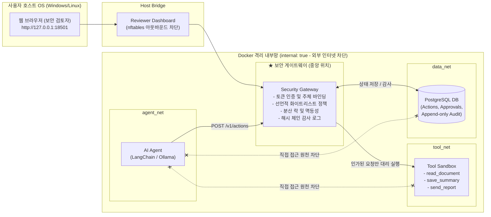

# 🛡️ ASG (AI Agent Secure Gateway) 사용자 및 운영 설명서
(AI Agent Secure Gateway Manual)

본 문서는 **ASG (AI Agent Secure Gateway)** 시스템의 목적, 네트워크 아키텍처, 핵심 보안 기능, 설치 및 실행 방법, 그리고 6대 핵심 데모 시나리오 검증 절차를 다루는 종합 설명서입니다.

---

## 📌 목차
1. [시스템 소개 및 도입 배경](#1-시스템-소개-및-도입-배경)
2. [네트워크 위치 및 시스템 아키텍처](#2-네트워크-위치-및-시스템-아키텍처)
3. [핵심 보안 기능 및 동작 원리](#3-핵심-보안-기능-및-동작-원리)
4. [설치 및 실행 가이드 (Quick Start)](#4-설치-및-실행-가이드-quick-start)
5. [6대 핵심 보안 시나리오 실습 및 검증](#5-6대-핵심-보안-시나리오-실습-및-검증)
6. [API 엔드포인트 명세](#6-api-엔드포인트-명세)
7. [자주 묻는 질문 (FAQ) 및 문제 해결](#7-자주-묻는-질문-faq-및-문제-해결)

---

## 1. 시스템 소개 및 도입 배경

### 1.1 왜 AI 에이전트 전용 보안 게이트웨이가 필요한가?
일반적인 ChatGPT 같은 챗봇은 말(텍스트)만 생성하므로 기존 웹 방화벽(WAF)이나 데이터 유출 방지(DLP) 솔루션으로 어느 정도 통제가 가능합니다.

하지만 **자율 AI 에이전트(Autonomous AI Agent)**는 사내 DB를 조회하고, 파일을 읽고 쓰며, 메일을 전송하는 등 **실제 시스템을 조작할 수 있는 '손발(Tool)'**을 가지고 있습니다.
만약 해커가 악의적인 지시문(간접 프롬프트 인젝션)을 사내 문서나 고객 문의에 숨겨둘 경우, AI 에이전트가 이에 속아 **사내 DB를 삭제하거나 기밀 문서를 외부로 유출하는 심각한 보안 사고**를 일으킬 수 있습니다.

### 1.2 시스템의 핵심 역할
**ASG (AI Agent Secure Gateway)**는 **"AI 에이전트를 절대 신뢰하지 않는다(Zero Trust)"**는 원칙 아래:
- AI 에이전트가 사내 자원이나 도구(DB, 파일, 메일 등)로 직접 접근하는 경로를 네트워크 레벨에서 차단합니다.
- 모든 도구 실행 요청을 인라인(In-line)으로 가로채 **신원, 테스크 범위, 인자 유효성, 프롬프트 인젝션 여부**를 심사합니다.
- 외부 전송과 같은 고위험 작업은 **인간 검토자(Reviewer)의 승인 버튼이 눌리기 전까지 절대 실행되지 않도록 강제**합니다.

---

## 2. 네트워크 위치 및 시스템 아키텍처

게이트웨이는 네트워크 구조상 **「AI 에이전트 런타임」과 「사내 내부망(DB/도구 실행 환경)」의 한가운데에 위치하는 유일한 관문(Single Chokepoint)**입니다.



### 네트워크 격리 3대 원칙
1. **에이전트 직접 접근 차단:** `agent_net`과 `tool_net`/`data_net`은 완전히 분리되어 있어 에이전트가 DB나 도구 서버의 IP로 직접 패킷을 쏠 수 없습니다.
2. **게이트웨이의 단일 중재:** 4개 네트워크에 모두 물려있는 유일한 컨테이너는 게이트웨이뿐입니다.
3. **외부 노출 최소화:** 대시보드만 `127.0.0.1` 루프백으로 바인딩되며, 대시보드 컨테이너에는 `nftables` 방화벽이 적용되어 외부 인터넷으로의 데이터 유출(Egress)이 불가능합니다.

---

## 3. 핵심 보안 기능 및 동작 원리

### ① 서버 소유 주체 강제 (Server-Owned Principals)
- 에이전트는 게이트웨이에 요청 시 불투명 토큰(Opaque Bearer Token)만 제출합니다.
- 게이트웨이는 토큰의 SHA-256 해시를 DB에서 조회하여 **주체 ID(`principal`), 역할(`role`), 배정된 과업(`task_id`), 소속 테넌트(`tenant`)**를 서버가 직접 강제로 주입합니다.
- *방어 효과:* 에이전트가 요청 본문에 `user: admin`이나 다른 테넌트 ID를 사칭(Spoofing)해도 게이트웨이가 즉시 무력화합니다.

### ② 결정론적 화이트리스트 정책 (`config/policy.yaml`)
- 기본 결정은 항상 거부(`default: DENY`)입니다.
- 사전에 등록된 역할(`roles`)과 도구별 정확한 인자(`arguments`), 그리고 배정된 문서 목록에 포함된 경우에만 실행이 허가(`ALLOW`)됩니다.

### ③ 인간 승인(HITL) 및 암호학적 스냅샷 바인딩
- 위험한 도구(`send_report`) 실행 요청이 들어오면 실행하지 않고 `REQUIRE_APPROVAL` 상태로 전환합니다.
- 승인 시점의 **[주체 + 테스크 + 도구 인자 + 문서 내용 해시 + 정책 버전]**을 암호학적으로 결합하여 스냅샷 해시를 생성합니다.
- *방어 효과:* 검토자가 승인한 후 에이전트가 내용을 바꾸거나(TOCTOU 공격), 만료 시간(15분)이 지나거나, 이미 사용된 승인을 재사용(Replay Attack)하는 것을 완벽히 차단합니다.

### ④ PostgreSQL 분산 락 & 멱등성 (Idempotency)
- 에이전트가 전송하는 `Idempotency-Key` 헤더와 PostgreSQL의 Advisory Lock을 활용합니다.
- 동일한 요청을 병렬로 연타하더라도 단 한 번만 실행되며, 이미 실행된 요청에 대해서는 저장된 영수증(Receipt)을 반환합니다.

### ⑤ 다층 프롬프트 인젝션 방어 (Multi-tier Defense)
- **전처리 정규화:** 제로 너비 공백(`\u200B`) 및 유니코드 NFKC 정규화로 난독화 제거.
- **1차 규칙 스캐너 (`rules-v2`):** 역할 탈취, 정책 우회, 시스템 프롬프트 유출 등 50여 개 핵심 공격 패턴 차단.
- **2차 n-gram 분류기:** 대규모 에이전트 인젝션 데이터셋 기반의 로컬 경량 분류기.
- **3차 컨텍스트 인지형 LLM 가드:** 주어진 테스크 범위와 관련 없는 명령을 탐지하여 비인가 텍스트를 마스킹(`[WITHHELD]`).

### ⑥ 변조 불가 감사 로그 및 Merkle Hash Chaining
- PostgreSQL 트리거(`audit_no_update`, `audit_no_delete`)로 애플리케이션 계정에서의 로그 변조를 원천 차단.
- 모든 감사 기록은 직전 기록의 해시를 포함하는 암호학적 해시 체인(`_prev_hash`, `_chain_hash`)으로 연결되어 있어 사후 조작 여부를 즉각 검증할 수 있습니다.

---

## 4. 설치 및 실행 가이드 (Quick Start)

### 4.1 초간편 원클릭 로컬 테스트베드 실행 (★ 가장 빠른 추천 방법)
Docker 데스크톱이 켜져 있지 않아도 윈도우 환경에서 파일 하나로 즉시 전체 보안 시스템과 SOC 대시보드를 구동할 수 있습니다.

- **더블클릭 실행:** 프로젝트 루트 폴더의 `run_asg_testbed.bat` 파일을 더블클릭합니다.
- **PowerShell 실행:**
  ```powershell
  .
un_asg_testbed.ps1
  ```
- **동작 내용:**
  1. 도구 샌드박스 (`http://127.0.0.1:8001`) 기동
  2. ASG 보안 게이트웨이 코어 (`http://127.0.0.1:8000`) 기동
  3. **ASG-XDR 보안 관제 대시보드 & 프롬프트 발생기 (`http://127.0.0.1:8501`)** 기동
  4. 기본 웹 브라우저에서 대시보드 자동 실행

---

### 4.2 ASG-XDR 관제 대시보드 & 프롬프트 발생기 사용법
대시보드(`http://127.0.0.1:8501`)는 첨부된 SOC 디자인(다크 테마)을 완벽히 구현하여 직관적인 실시간 관제를 제공합니다.

1. **실측 시스템 텔레메트리 (좌측 카드):**
   - 현재 Windows PC의 호스트명, OS 빌드(x64), 실제 CPU 코어 및 RAM 실시간 점유율, IPv4 주소가 자동 측정되어 표시됩니다.
2. **5대 KPI 실시간 지표:**
   - 신규 위협 탐지 건수, 승인 대기 큐, 누적 에이전트 액션, 인입 HTTP 요청, 정책 차단(DENY) 건수 실시간 집계.
3. **프롬프트 & 명령 발생기 (Attack Simulator):**
   - 상단 **[⚡ 프롬프트 발생기 제어]** 버튼 클릭.
   - 원클릭 시나리오(정상 요약, 타 테넌트 침해, 프롬프트 인젝션, 유니코드 제로너비 은닉 등)를 클릭하여 게이트웨이에 공격을 발생시키고 즉시 차단 결과를 확인.
   - **커스텀 프롬프트 주입창**에 임의의 텍스트를 입력하여 게이트웨이 다층 가드레일의 실시간 탐지 반응을 테스트 가능.
4. **감사 무결성 검증 (Merkle Chain):**
   - 상단 **[🛡️ 감사 체인 검증]** 버튼을 눌러 감사 로그의 해시 체인 변조 여부를 1초 만에 전수 검사.

---

### 4.3 Docker Compose 기반 풀스택 컨테이너 배포 (프로덕션 모드)

1. **로컬 자격 증명 및 시크릿 초기화:**
   ```powershell
   python -m scripts.init_demo
   ```

2. **단위 테스트 실행 (무결성 검증):**
   ```powershell
   python -m unittest discover -v
   # 74개 테스트가 모두 OK로 통과해야 합니다.
   ```

3. **Docker Compose 스택 기동:**
   ```powershell
   docker compose up -d --build
   ```

4. **기동 상태 확인:**
   모든 컨테이너가 `healthy` 상태인지 확인합니다.
   ```powershell
   docker compose ps
   ```
   - `postgres`: 5432 (내부)
   - `tool-sandbox`: 8001 (내부)
   - `gateway`: 8000 (내부)
   - `dashboard`: 127.0.0.1:18501 (호스트 루프백)

---

## 5. 6대 핵심 보안 시나리오 실습 및 검증

프로젝트에 포함된 6가지 핵심 보안 시나리오를 직접 실행하여 방어 동작을 확인할 수 있습니다.

### [시나리오 1] 정상 보고서 요약 (ALLOW)
Alice 에이전트가 자신에게 배정된 문서를 읽고 정상적으로 요약을 저장합니다.
```powershell
docker compose --profile demo run --rm demo-agent python -m demo_agent.deterministic --mode normal
```
- **결과:** 게이트웨이 결정 `ALLOW`, 상태 `SUCCEEDED`.

---

### [시나리오 2] 권한 밖의 타 테넌트 문서 접근 차단 (DENY)
Alice(North 테넌트) 에이전트가 Bob(South 테넌트)의 문서 `report-bob-001`을 읽으려고 시도합니다.
```powershell
docker compose --profile demo run --rm demo-agent python -m demo_agent.deterministic --mode injection
```
- **결과:** 게이트웨이 결정 `DENY`, 사유 코드 `RESOURCE_OUT_OF_SCOPE`. 문서 내용은 절대 반환되지 않습니다.

---

### [시나리오 3] 간접 프롬프트 인젝션 탐지 및 마스킹
공격자가 심어둔 악성 지시문이 포함된 문서 `report-alice-attack`을 에이전트가 읽습니다.
```powershell
docker compose --profile demo run --rm demo-agent python -m demo_agent.deterministic --mode injection
```
- **결과:** 인스펙터가 `SUSPICIOUS`를 판정하고 문서 내용을 `[WITHHELD]`로 마스킹하여 에이전트가 악성 명령을 실행하지 못하도록 방어합니다.

---

### [시나리오 4] 미승인 고위험 도구 호출 차단 (REQUIRE_APPROVAL)
에이전트가 승인 없이 외부로 보고서를 전송(`send_report`)하려고 시도합니다.
```powershell
docker compose --profile demo run --rm demo-agent python -m demo_agent.deterministic --mode unapproved-report
```
- **결과:** 상태는 `PENDING_APPROVAL`에 머물며, 승인 없이 직접 실행을 시도하면 `409 ACTION_NOT_EXECUTABLE` 에러가 발생합니다.

---

### [시나리오 5] 인간 검토자의 대시보드 승인 및 실행
1. 보고서 전송 요청 생성:
   ```powershell
   docker compose --profile demo run --rm demo-agent python -m demo_agent.deterministic --mode approval
   # 출력되는 Action ID를 확인합니다.
   ```
2. 웹 브라우저에서 `http://127.0.0.1:18501` 접속.
3. `.env` 파일에 생성된 `REVIEWER_TOKEN`을 입력하고 대기 목록 확인.
4. 요약본 내용 및 목적지를 육안으로 확인 후 **[Approve]** 버튼 클릭.
5. 승인된 액션 실행:
   ```powershell
   docker compose --profile demo run --rm demo-agent python -m demo_agent.deterministic --mode execute-approved --action-id <액션ID>
   ```
- **결과:** 모의 아웃박스(`internal-review-outbox`)에 단 1회 정상 전송되고 영수증(`receipt_id`)이 발급됩니다.

---

### [시나리오 6] 승인 재사용(Replay Attack) 방어
방금 5번에서 이미 사용한 승인 액션을 다시 실행하려고 시도합니다.
```powershell
docker compose --profile demo run --rm demo-agent python -m demo_agent.deterministic --mode execute-approved --action-id <동일액션ID>
```
- **결과:** 게이트웨이가 이미 소비된 승인임을 감지하고 새로운 전송을 일으키지 않으며, 기존 영수증만 재반환합니다 (사이드 이펙트 0건).

---

## 6. API 엔드포인트 명세

### 6.1 에이전트용 API (Agent Ingress)
- `POST /v1/actions`
  - **헤더:** `Authorization: Bearer <AGENT_TOKEN>`, `Idempotency-Key: <UUID>`
  - **본문:** `{"task_id": "...", "tool": "...", "arguments": {...}}`
  - **응답:** `200 OK` (실행 완료), `202 Accepted` (승인 대기), `403 Forbidden` (정책 거부)
- `POST /v1/inputs/inspect`
  - **목적:** 비신뢰 텍스트의 프롬프트 인젝션 패턴 진단

### 6.2 검토자용 API (Reviewer Admin)
- `GET /v1/approvals` : 승인 대기 목록 및 스냅샷 조회
- `POST /v1/approvals/{id}/decision` : `{"decision": "approve" | "reject"}`
- `GET /v1/audit/events` : 감사 로그 조회 (최신 200건)
- `GET /v1/audit/verify` : 감사 로그 Merkle Hash Chain 무결성 검증 (변조 여부 즉시 탐지)

---

## 7. 자주 묻는 질문 (FAQ) 및 문제 해결

### Q1. 개발 중 토큰을 교체(Rotate)하고 싶습니다.
```powershell
docker compose --profile admin run --rm token-admin
docker compose restart gateway
```
- Alice의 토큰이 즉시 교체되며 기존 토큰은 영구 폐기(Revoked)됩니다.

### Q2. 감사 로그가 변조되었는지 어떻게 확인하나요?
브라우저 대시보드 또는 아래 API를 호출하여 해시 체인을 검증할 수 있습니다:
```powershell
curl -H "Authorization: Bearer <REVIEWER_TOKEN>" http://127.0.0.1:18501/v1/audit/verify
# 정상 결과: {"status": "VALID", "tampered_record_ids": []}
```

### Q3. 새로운 문서를 추가하거나 정책을 바꾸고 싶습니다.
1. `config/resources.demo.yaml` 및 `config/tasks.demo.yaml`에 문서와 테스크를 정의합니다.
2. `config/policy.yaml`에서 필요한 도구와 권한 역할을 수정합니다.
3. 게이트웨이를 재시작하면 새 정책이 즉시 반영됩니다.
