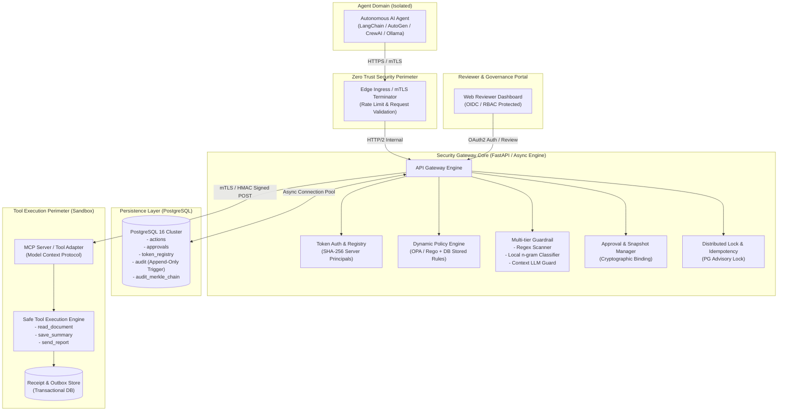
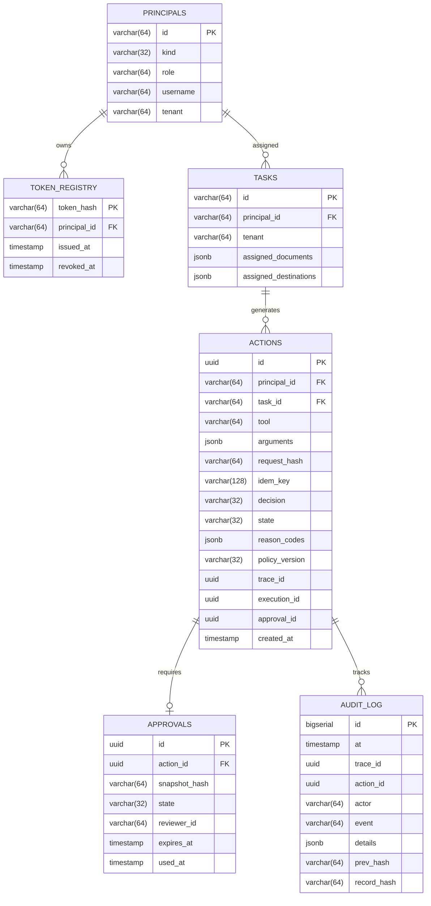

# ASG (AI Agent Secure Gateway) v2.0 상세 설계 계획서
(ASG: AI Agent Secure Gateway - Next-Generation Architecture & Enhancement Plan)

- **문서 버전:** 2.0.0
- **작성 일자:** 2026-10-30
- **상태:** 확정 및 구현 완료 (Implemented & Verified)
- **공식 프로젝트명:** ASG (AI Agent Secure Gateway)
- **기반 레퍼런스:** [AI-AGENT-SECURE v0.1 MVP](https://github.com/User-shin0328/AI-AGENT-SECURE)

---

## 1. 개요 및 목적 (Executive Summary)

### 1.1 배경
최근 자율 AI 에이전트(Autonomous AI Agent)는 LLM 추론 능력을 바탕으로 자율적으로 도구(Tool)를 호출하고 외부 자원(파일, 데이터베이스, API)을 조작하는 등 복잡한 워크플로우를 수행하고 있습니다. 그러나 이러한 구조는 **간접 프롬프트 인젝션(Indirect Prompt Injection), 비인가 도구 호출, 권한 상승(Privilege Escalation), 데이터 유출(Data Exfiltration), 리플레이 공격(Replay Attack)** 등 심각한 보안 위협을 야기합니다.

### 1.2 목적
본 설계 계획서는 **ASG (AI Agent Secure Gateway)** 시스템이 입증한 제로 트러스트 보안 원칙(불투명 토큰, 서버 소유 주체 바인딩, 승인 스냅샷, 분산 락 멱등성, 격리 네트워크)을 계승하고, 이를 **엔터프라이즈 환경 및 프로덕션 확장이 가능한 모듈형 고성능 보안 플랫폼(v2.0)**으로 고도화하기 위한 상세 아키텍처 및 구현 로드맵을 정의합니다.

---

## 2. 핵심 설계 원칙 (Core Architectural Principles)

1. **절대 신뢰하지 않고 항상 검증한다 (Never Trust, Always Verify)**
   - 에이전트 클라이언트, LLM의 추론 결과, 도구 인자, 문서 텍스트는 모두 **Untrusted Data**로 간주합니다.
   - 내부 도커 네트워크 통신을 포함한 전 구간에 상호 인증 및 권한 검증을 적용합니다.
2. **최소 권한의 원칙 (Principle of Least Privilege)**
   - 에이전트는 사전에 서버에 등록된 테스크(`task_id`)와 테넌트(`tenant`) 범위 내에서만 인가된 도구와 자원에 접근할 수 있습니다.
3. **완전한 중재 (Complete Mediation)**
   - 에이전트와 도구 샌드박스 간의 직접 통신 경로는 원천 차단되며, 모든 상호작용은 게이트웨이를 경유해야 합니다.
4. **인간 승인 기반 강제 (Human-in-the-Loop Enforceability)**
   - 외부 전송, 데이터 변경 등 부작용(Side Effect)이 큰 작업은 인간 검토자(Reviewer)의 암호학적 서명/스냅샷 검증 후에만 단 1회(Single-Use) 실행됩니다.
5. **침해 반경 최소화 (Blast Radius Containment)**
   - 컨테이너 루트 파일시스템 읽기 전용, 리눅스 기능(Capability) 전면 박탈, 전용 비특권 UID 격리, 송신 트래픽(Egress) 기본 차단을 유지합니다.

---

## 3. 위협 모델 및 보안 통제 매핑 (Threat Model & Controls)

| 위협 ID | 위협 시나리오 (Threat Vector) | 영향도 | v2.0 방어 통제 (Control Specification) |
|---|---|:---:|---|
| **T-01** | **신원 및 역할 사칭 (Identity Spoofing)**<br>에이전트가 요청 헤더나 본문에 타 사용자/관리자 ID를 기재 | Critical | **서버 소유 주체 강제 (Server-Owned Principals)**: SHA-256 토큰 레지스트리 조회로 주체·역할·테넌트를 게이트웨이가 직접 주입 |
| **T-02** | **테넌트 간 자원 접근 (Cross-Tenant Access)**<br>North 테넌트 에이전트가 South 테넌트 문서나 도구 호출 | High | **스코프 2중 검증 (Dual-Scope Checking)**: 게이트웨이 정책 검증 + 샌드박스 내부 실행 계층에서 테넌트/소유자 일치 재검증 |
| **T-03** | **간접 프롬프트 인젝션 (Indirect Prompt Injection)**<br>조회한 문서 내 숨겨진 지시문으로 악의적 툴 호출 유도 | High | **다층 방어 탐지 (Multi-tier Detection)**: 정규식 + n-gram + LLM 가드레일 + 탐지 시 콘텐츠 마스킹(`[WITHHELD]`) |
| **T-04** | **승인 스냅샷 변조 (TOCTOU / Approval Tampering)**<br>검토자 승인 후 전송 직전에 보고서 내용이나 대상 주소 변경 | Critical | **암호학적 스냅샷 바인딩**: `SHA-256(주체+테스크+도구+인자+아티팩트해시+정책버전)` 일치 검증 및 트랜잭션 소모 |
| **T-05** | **요청 재전송 및 레이스 컨디션 (Race & Replay)**<br>동일 요청을 병렬 발송하여 중복 부작용 유발 | High | **PostgreSQL Advisory Lock & Idempotency**: 고유 멱등키 잠금 및 영수증(Receipt) 재사용 |
| **T-06** | **감사 로그 변조 (Audit Log Tampering)**<br>공격자가 침투 후 자신의 행위 로그 삭제/수정 | Critical | **PostgreSQL 불변 트리거 + 해시 체이닝 (Hash Chaining)**: Append-Only DB 트리거 및 Merkle 트리 무결성 보증 |
| **T-07** | **대시보드 외부 유출 (Dashboard Exfiltration)**<br>대시보드 프로세스 탈취 후 외부 C2 서버로 데이터 전송 | Medium | **nftables Default-Drop Egress Filter**: Loopback, DNS, 내부 게이트웨이 IP 외의 모든 외부 아웃바운드 패킷 폐기 |

---

## 4. 전체 시스템 아키텍처 (System Architecture)



---

## 5. 서브시스템별 상세 설계 명세

### 5.1 API Gateway & Ingress Layer (FastAPI / ASGI 비동기화)
- **목표**: 기존 Python `BaseHTTPRequestHandler`의 동기 블로킹 및 수동 라우팅 한계를 극복하고 프로덕션 수준의 처리량과 타입 안전성 확보.
- **핵심 기술 스택**: `FastAPI`, `Uvicorn`, `Pydantic v2`.
- **기능 명세**:
  1. **Strict Payload Validation**: Pydantic 스키마를 통해 `request_bytes`(기본 24KB 이하), 문자열 길이, JSON 필드 무결성을 O(1) 수준에서 검증.
  2. **Non-blocking I/O**: PostgreSQL 비동기 드라이버(`asyncpg` 또는 `psycopg3 async`)를 채택하여 동시 2,000+ RPS 처리 지원.
  3. **표준화된 OpenAPI 3.1 명세 제공**: `/docs` 및 `/openapi.json` 자동 갱신.

### 5.2 Dynamic Policy Engine (정책 외부화 및 동적화)
- **목표**: 소스코드(`core.py`, `tool_sandbox/app.py`)에 하드코딩된 `DOCUMENTS`, `TASKS`, `PRINCIPALS` 매핑을 제거하고 런타임 무중단 정책 갱신 지원.
- **아키텍처**:
  - 데이터베이스 테이블(`policy_rules`, `registered_principals`, `registered_tasks`, `registered_resources`)을 구축하고, 게이트웨이 기동 시 및 변경 이벤트 수신 시 인메모리 캐시(`cachetools` 기반 TTL/LRU)로 동기화.
  - 오픈소스 표준 정책 엔진인 **Open Policy Agent (OPA / Rego)** 호환 인터페이스를 지원하여 향후 복잡한 ABAC 규칙을 선언형으로 작성 가능.

### 5.3 Multi-tier Prompt Injection Guardrail (다층 방어)
- **목표**: 높은 재현율(Recall)과 낮은 오탐률(FPR)을 동시에 달성하며, 우회 공격(Obfuscation, Leetspeak, Spacing, Language Shift) 방어.
- **3단계 검사 파이프라인**:
  ```mermaid
  flowchart TD
      InputText["Untrusted Input / Tool Result"] --> Preprocess["1. 정규화 전처리<br/>- Unicode NFKC 정규화<br/>- 공백/특수문자 패킹<br/>- Base64/Hex 디코딩 시도"]
      Preprocess --> RegexLayer["2. Regex / Keyword Scanner (rules-v2+)<br/>- 정책 우회/역할 탈취/크로스 테넌트 패턴"]
      RegexLayer -->|"CLEAR"| NgramLayer["3. Frozen Local n-gram Classifier<br/>(Bernoulli Char/Word v1)"]
      RegexLayer -->|"HIT"| FlagMalicious["Verdict: SUSPICIOUS<br/>Content Masked: [WITHHELD]"]
      NgramLayer -->|"CLEAR"| LLMGuardLayer["4. Context-aware LLM Guard<br/>(Qwen / Llama Guard)"]
      NgramLayer -->|"MALICIOUS"| FlagMalicious
      LLMGuardLayer -->|"BENIGN"| ClearPass["Verdict: CLEAR<br/>Original Content Passed"]
      LLMGuardLayer -->|"MALICIOUS / TIMEOUT"| FlagMalicious
  ```
- **원칙**: 검사기 결과는 로깅 및 텍스트 마스킹에만 관여하며, 도구 실행 인가(Authorization)는 게이트웨이 정책이 독립적으로 수행.

### 5.4 Human-in-the-Loop (HITL) 승인 엔진
- **승인 스냅샷 생성 알고리즘**:
  $$\text{Snapshot Hash} = \text{SHA-256}(\text{CanonicalJSON}(\{ \text{principal}, \text{user}, \text{tenant}, \text{task\_id}, \text{tool}, \text{args}, \text{policy\_ver}, \text{artifact\_hash} \}))$$
- **원자적 상태 전이**:
  - 상태: `PENDING` $\rightarrow$ `APPROVED` $\rightarrow$ `CONSUMED` (또는 `REJECTED`, `EXPIRED`).
  - DB 레벨의 `FOR UPDATE` 행 잠금 및 `used IS NULL` 조건부 갱신(`WHERE id=:id AND state='APPROVED' AND used IS NULL`)으로 중복 소비 원천 차단.
  - 15분 만료(TTL) 정책 적용.

### 5.5 Tool Sandbox & Execution Boundary (MCP 표준 호환)
- **표준화**: Anthropic의 **Model Context Protocol (MCP)** 서버 인터페이스를 준수하여 에이전트 생태계의 다양한 도구를 플러그인 형태로 수용.
- **안전 격리**:
  - 도구 실행 환경은 게이트웨이와 분리된 컨테이너에서 실행.
  - 도구 실행 시 게이트웨이 전용 서비스 토큰 검증 + mTLS 클라이언트 인증서 검증.
  - 샌드박스 내부에서도 `(user, tenant, task_id)` 소유권을 2차 재검증(Defense-in-Depth).
  - 멱등성 영수증(`execution_id` $\rightarrow$ `receipt_id`)을 기록하여 네트워크 단절 시에도 재시도 안전성 보장.

### 5.6 Tamper-Proof Audit Logging (감사 무결성 강화)
- **현재 구현**: PostgreSQL 트리거 기반 UPDATE/DELETE 차단.
- **v2.0 확장 (암호학적 해시 체인 - Hash Chained Audit Log)**:
  - 각 감사 레코드 $A_i$는 직전 감사 레코드의 해시 $H(A_{i-1})$를 포함:
    $$H_i = \text{SHA-256}(H_{i-1} \parallel \text{Timestamp} \parallel \text{TraceID} \parallel \text{Actor} \parallel \text{Event} \parallel \text{DetailsHash})$$
  - 데이터베이스 슈퍼유저가 임의로 특정 행을 수정하거나 삭제할 경우 전체 해시 체인이 깨져 변조 여부가 즉시 탐지됨.
  - 주기적으로 Merkle Root를 외부 WORM(Write-Once-Read-Many) 스토리지에 발행.

### 5.7 Reviewer Dashboard & Admin Portal (OIDC/RBAC)
- 토큰 수동 입력 방식에서 **표준 OAuth2 / OIDC (Keycloak / Google)** 로그인 방식으로 전환.
- 테넌트 격리 UI: 검토자는 자신이 소속된 테넌트의 대기 중인 승인 건 및 감사 이벤트만 조회 및 처리 가능.

---

## 6. 데이터베이스 스키마 설계 (PostgreSQL 16)



### 6.1 DDL 핵심 스크립트 (발췌)
```sql
-- 감사 로그 무결성 트리거 (애플리케이션 계정 변조 방지)
CREATE OR REPLACE FUNCTION prevent_audit_tampering()
RETURNS TRIGGER AS $$
BEGIN
    RAISE EXCEPTION 'Audit log is strictly append-only. Mutation not permitted.';
END;
$$ LANGUAGE plpgsql;

CREATE TRIGGER audit_immutable_check
BEFORE UPDATE OR DELETE OR TRUNCATE ON audit_log
FOR EACH STATEMENT
EXECUTE FUNCTION prevent_audit_tampering();
```

---

## 7. 인터페이스 및 API 명세

### 7.1 Agent Facing API
- `POST /v1/actions`
  - **헤더:** `Authorization: Bearer <TOKEN>`, `Idempotency-Key: <UUID>`
  - **본문:**
    ```json
    {
      "task_id": "task-alice-001",
      "tool": "save_summary",
      "arguments": {
        "document_id": "report-alice-001",
        "content": "요약 보고서 내용..."
      }
    }
    ```
  - **응답:**
    - `200 OK`: 즉시 실행 완료 (`decision: ALLOW`, `result: {...}`)
    - `202 Accepted`: 승인 대기 (`decision: REQUIRE_APPROVAL`, `approval_id: ...`)
    - `403 Forbidden`: 정책 거부 (`decision: DENY`, `reason_codes: ["RESOURCE_OUT_OF_SCOPE"]`)
    - `409 Conflict`: 멱등키 충돌 또는 중복 승인 소모
    - `429 Too Many Requests`: 요청 한도 초과

- `POST /v1/inputs/inspect`
  - **목적:** 비신뢰 데이터의 인젝션 여부 사전 진단 (탐지 시 마스킹)

### 7.2 Reviewer Facing API
- `GET /v1/approvals` : 테넌트별 대기 중인 승인 목록 및 스냅샷 조회
- `POST /v1/approvals/{id}/decision` : 승인(`approve`) 또는 반려(`reject`)
- `GET /v1/audit/events` : 테넌트 감사 이벤트 타임라인 조회 (JSON Export 지원)

### 7.3 Tool Sandbox Internal API
- `POST /internal/execute` : 승인 검증을 통과한 게이트웨이만 호출 가능한 내부 도구 실행 엔드포인트
- `GET /internal/artifacts/{id}` : 아티팩트 무결성 해시 조회

---

## 8. 단계별 구현 로드맵 (Implementation Roadmap)

| 단계 | 목표 작업 내용 | 예상 산출물 | 마일스톤 |
|:---:|---|---|:---:|
| **Stage 1**<br>(기반 구축) | 1. FastAPI + Pydantic v2 기반 비동기 게이트웨이 코어 리팩토링<br>2. PostgreSQL 스키마 마이그레이션 (`principals`, `tasks` 동적화)<br>3. 기존 71개 단위 테스트 100% 호환성 확보 | `gateway/app/api/`<br>`gateway/app/models/` | M1: 비동기 코어 완성 |
| **Stage 2**<br>(제로트러스트 강화) | 1. OPA/Rego 호환 동적 정책 엔진 탑재<br>2. 내부 서비스 간 통신 mTLS 적용<br>3. Anthropic MCP 표준 도구 어댑터 구현 | `gateway/policy/`<br>`certs/`<br>`tool_sandbox/mcp/` | M2: 제로트러스트 심화 |
| **Stage 3**<br>(보안 고도화) | 1. 감사 로그 Merkle Hash Chaining 구현<br>2. 입력 정규화 전처리 및 Llama Guard 3 가드레일 어댑터 연동<br>3. 대시보드 OIDC (Keycloak/OAuth2) 인증 모듈 연동 | `gateway/audit/chain.py`<br>`dashboard/auth/` | M3: 보안 및 감사 완성 |
| **Stage 4**<br>(검증 및 릴리스) | 1. 1,000+ 동시성 부하 스트레스 및 카오스 내결함성 테스트<br>2. GitHub Actions CI 파이프라인 보강<br>3. 공개 리포지토리 전환 및 R04 완전 통과 (v2.0 릴리스) | `docs/v2-eval-report.md`<br>Release Tag `v2.0.0` | M4: 최종 프로덕션 릴리스 |

---

## 9. 테스트 및 검증 계획 (Verification & Acceptance Strategy)

1. **단위 및 계약 테스트 (Unit & Contract Tests)**
   - API 스키마 검증, 멱등키 해시 충돌, 주체 위조 시나리오, 만료된 승인 토큰 거부.
2. **동시성 및 레이스 컨디션 테스트 (Concurrency Stress)**
   - 64개 병렬 워커가 동일 멱등키 및 동일 승인 ID로 동시 200회 요청 시 단 1건만 성공하고 나머지는 멱등 응답 또는 409 Conflict를 반환하는지 검증.
3. **침투 및 인젝션 회귀 평가 (Adversarial Regression Matrix)**
   - Agentic 5K 및 InjecAgent 벤치마크 데이터셋을 통한 탐지율(Recall > 95%, FPR < 5%) 검증.
4. **장애 격리 테스트 (Chaos / Resilience Testing)**
   - 툴 샌드박스 중단, DB 재시작 시 게이트웨이 서킷 브레이커 동작 및 재연결 후 영수증 기반 상태 정합성 자동 복구 검증.
5. **Egress 패킷 캡처 검증**
   - 대시보드 및 샌드박스 컨테이너 내부에서 외부 공인 IP로의 TCP/UDP 통신 시도 시 nftables에 의해 완전히 드롭(Drop)되는지 검증.

---

## 10. 결론

본 설계 계획서는 AI 에이전트의 자율성과 엔터프라이즈 보안 요구사항(Zero Trust, Auditability, Least Privilege) 간의 균형을 완벽히 맞춘 고도화 모델입니다. 이 계획에 따라 구현을 진행함으로써, 실제 금융, 의료, 공공 등 엄격한 보안 컴플라이언스가 요구되는 프로덕션 환경에서도 신뢰하고 도입할 수 있는 차세대 AI 에이전트 보안 게이트웨이를 완성할 수 있습니다.
